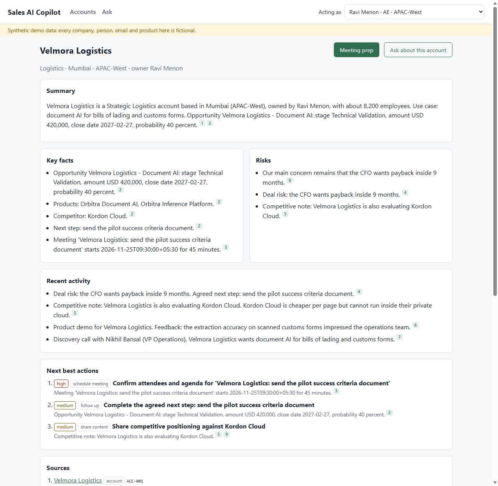
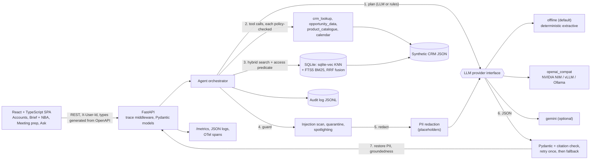

# Sales AI Copilot (full-stack PoC)

A full-stack assistant for enterprise sellers: **account briefs, meeting preparation, next-best-actions and Q&A**, every claim cited back to a source record. It runs on synthetic CRM data and enforces enterprise controls (role- and territory-based access at retrieval time, PII redaction before any model call, prompt-injection defence, audit log) with observability (trace IDs, JSON logs, Prometheus metrics, OpenTelemetry spans) and an evaluation gate in CI.

**Why:** a portfolio project for production generative-AI applications in enterprise sales workflows: React/TypeScript front end, typed FastAPI back end, hybrid RAG on a vector database, an agentic tool-calling workflow, a pluggable LLM layer with NVIDIA NIM as the primary hosted option, and the testing, CI/CD and deployment artefacts around it.

> All companies, people, emails, phone numbers and products are fictional (`backend/scripts/generate_data.py`). The default LLM mode is a **deterministic offline generator, not an LLM**. It lets the whole pipeline run with no API key and makes the tests reproducible. No LLM-mode results are reported because no LLM key was available while this was built.



## Architecture



Request flow for `POST /api/ask` (the workflows use a fixed tool plan instead of step 1):

1. **Plan**: the model (or the offline rule planner) returns a `ToolPlan` JSON. The plan can only narrow scope: an account the user cannot see is dropped.
2. **Tools**: deterministic tools run *as the caller*, each applying the access policy itself.
3. **Retrieve**: hybrid search. The caller's territory, record-type and sensitivity predicate is in the SQL of both the KNN query and the BM25 query, so out-of-scope records are never scored.
4. **Guard**: evidence matching injection patterns is quarantined (its text is replaced) and evidence is wrapped in `<evidence>` tags that the system prompt marks as untrusted data.
5. **Redact**: emails, phone numbers and known contact names become `[EMAIL_1]`, `[PHONE_1]`, `[PERSON_1]` before any provider call.
6. **Generate and validate**: JSON is parsed and validated against the Pydantic schema. Citations to IDs that were not supplied are removed. One retry with the validation error, then fallback to the offline generator (recorded in `meta.fallback_reason`).
7. **Post-process**: placeholders are restored for the authorised user, a lexical groundedness check runs, and an audit entry and metrics are written.

## Run it

Prerequisites: Python 3.14 (3.12+ should work but was not tested), Node 24, npm. SQLite must allow extension loading (true for the python.org Windows build used here).

```powershell
# from the project root
python -m venv .venv
.venv\Scripts\python -m pip install -r backend/requirements-dev.txt

# backend on :8000 (offline mode, no key needed)
cd backend
..\.venv\Scripts\python -m uvicorn app.main:create_app --factory --port 8000
# OpenAPI docs: http://localhost:8000/docs   metrics: http://localhost:8000/metrics

# front end on :5173 (second terminal; proxies /api to :8000)
cd frontend
npm ci
npm run dev
```

Use the "Acting as" selector to switch between the SDR, account executive and sales manager personas and see access control change what the assistant can use.

### Tests, evaluation and checks

```powershell
cd backend
..\.venv\Scripts\python -m pytest -q                 # unit + API tests
..\.venv\Scripts\python -m eval.run_eval --gate      # offline evaluation gate
cd ..\frontend
npm test                                             # vitest + Testing Library
npm run build                                        # tsc type-check + Vite production build
cd ..
.venv\Scripts\python scripts/validate_manifests.py   # Kubernetes / compose / CI YAML checks
```

Regenerate artefacts: `python backend/scripts/generate_data.py` (synthetic data), `python backend/scripts/export_openapi.py` then `npm run gen:api` (OpenAPI spec and TypeScript types).

### LLM providers (one interface, chosen by environment)

| Mode | Settings | Notes |
|---|---|---|
| Offline (default) | nothing, or `LLM_PROVIDER=offline` | Rule-based planner and extractive generator. Deterministic. Not an LLM. |
| NVIDIA NIM (API catalog) | `NVIDIA_API_KEY=nvapi-...` (auto-selects `openai_compat`) | `LLM_BASE_URL` defaults to `https://integrate.api.nvidia.com/v1`. `LLM_MODEL` defaults to `meta/llama-3.3-70b-instruct`; confirm the model is still listed in the catalog. |
| Self-hosted NIM, vLLM, Ollama | `LLM_PROVIDER=openai_compat`, `LLM_BASE_URL=http://host:port/v1`, `LLM_MODEL=...`, optional `LLM_API_KEY` | Same code path; for example Ollama at `http://localhost:11434/v1`. |
| Gemini (optional) | `GEMINI_API_KEY=...` or `LLM_PROVIDER=gemini` | REST `generateContent` with JSON response MIME type. |

`LLM_API_KEY` takes precedence over `NVIDIA_API_KEY`. `LLM_JSON_MODE=true` also sends `response_format={"type":"json_object"}` for servers that support it. The NIM and Gemini clients are tested against mocked HTTP only (request shape, auth header, usage parsing, error handling); **they were not called against live endpoints.**

Embeddings: `EMBEDDER=hash` (default; deterministic feature hashing, no download) or `EMBEDDER=fastembed` (local `BAAI/bge-small-en-v1.5` ONNX model through fastembed, about 65 MB downloaded once into `backend/.models`, then offline). Install with `pip install -r backend/requirements-local-embeddings.txt`. `EMBEDDER=finetuned` loads a bge-small fine-tuned on this corpus from `backend/.models/bge-small-en-v1.5-sales-ft` (ONNX through fastembed, no torch at runtime); build it with [backend/finetune](backend/finetune/README.md). If the files are missing, startup fails with instructions rather than falling back silently.

## Results (real, offline mode, run on 2026-11-24)

**Tests:** backend `pytest`: **58 passed** (2 of them load the locally built fine-tuned embedder and are skipped when it is absent, as in CI). Front end `vitest`: **3 passed** (citation chips, empty state, and the Ask page sending the acting user's ID and rendering a cited answer). Front end production build: **succeeded** (`tsc` clean; JS bundle 275 kB, 86.6 kB gzipped). Manifest validation: 9 Kubernetes documents, compose and CI files parsed, no problems.

**Evaluation** (`backend/eval/golden.json`: 33 questions = 22 direct, 5 paraphrased with little keyword overlap, 5 access-control negatives, 1 injection probe; plus a sweep of 5 personas x 12 accounts x 3 workflows). 96 responses and 129 model requests were inspected.

| Metric | hash embedder | fastembed bge-small |
|---|---|---|
| Evidence hit rate (expected source reached the model; tools + retrieval) | 0.963 | 0.963 |
| Retrieval-only hit@6: vector / keyword / hybrid | 0.963 / 0.926 / 0.963 | 1.000 / 0.926 / 0.963 |
| Paraphrased subset hit@6: vector / keyword / hybrid | 0.8 / 0.6 / 0.8 | 1.0 / 0.6 / 0.8 |
| Citation hit rate (an expected source was cited) | 0.815 | 0.815 |
| Citation validity (cited IDs that were in the supplied evidence) | 1.0 | 1.0 |
| Answer contains the expected fact | 0.815 (22/22 direct, 0/5 paraphrased) | 0.815 |
| Groundedness, lexical proxy (Ask / workflows) | 1.0 / 1.0 | 1.0 / 1.0 |
| **Access-control leakage** (records outside the caller's scope in evidence or citations) | **0** | **0** |
| Negative-case violations / unauthorised requests not given 404 | 0 / 0 | 0 / 0 |
| Injection text reaching a model / appearing in output | 0 / 0 | 0 / 0 |
| Planted injection note retrieved and quarantined | 20 times | 20 times |
| Contact PII values found in model prompts | 0 | 0 |

How to read this honestly:

- Groundedness of 1.0 is **by construction**: the offline generator copies sentences from the evidence. The check exists for LLM modes, where it would measure something real; it is a word-overlap proxy, not an entailment model.
- The offline generator scores 0/5 on paraphrased questions because it matches words. Retrieval found the right record for most of them; turning that into an answer needs an LLM.
- With the local model, vector-only retrieval found all 5 paraphrases but hybrid found 4: reciprocal rank fusion let a weak keyword ranking push a correct vector hit out of the top 6. A reranker (for example a NeMo Retriever reranking NIM) or weighted fusion is the next step.
- The golden set is small (27 positive questions) and written by the same author as the data, so these numbers show the pipeline works and catch regressions; they are not a benchmark.
- The evaluation caught a real bug during development: phone numbers with fewer than 10 digits (`+45 3555 181`) were not redacted. The rule was changed to accept 8+ digits after a `+`, and the gate now enforces `pii_values_in_prompts == 0`.
- CI gate thresholds (`GATES` in `run_eval.py`) are regression gates set at or just below the offline baseline, except leakage, injection and PII, which must be exactly 0.

### Embedder fine-tune: bge-small on a laptop CPU (no measurable gain)

[backend/finetune](backend/finetune/README.md) fine-tunes `BAAI/bge-small-en-v1.5` with a contrastive loss (MultipleNegativesRankingLoss with mined hard negatives). It trained on 796 synthetic questions (LLM plus templates) in 42 minutes on CPU, was exported to ONNX and is selectable with `EMBEDDER=finetuned`. Because the golden set is too easy to show a difference, a **68-question hand-written paraphrase test set was written and frozen before training**, and the baseline was measured on it first.

| Frozen test set, MRR@10 | base bge-small | fine-tuned | difference (95% CI) |
|---|---|---|---|
| vector, access-filtered | 0.817 | 0.838 | +0.021 (-0.061, +0.107) |
| hybrid, access-filtered (app default) | 0.867 | 0.844 | -0.024 (-0.081, +0.032) |
| vector, all 115 chunks visible | 0.770 | 0.804 | +0.035 (-0.051, +0.124) |

On held-out *synthetic* validation questions, vector MRR rose from 0.751 to 0.956. On the hand-written test set, the changes are within noise in both directions. The likely reason is that the generated questions reuse the records' words (65% content-word overlap with the answer passage versus 22% for the test questions). With `EMBEDDER=finetuned` the golden gate passes with identical metrics and zero leakage. The default embedder is unchanged.

Transfer to accounts left out of training was not measured (that run was stopped on the shared CPU). The accurate summary is "fine-tuned and measured: no significant gain on held-out paraphrases", not "improved retrieval".

## What was not done or not verified

- **No LLM-mode run** (no `NVIDIA_API_KEY` or `GEMINI_API_KEY` was available). Only mocked-HTTP tests cover those providers.
- **Docker was not installed**: the Dockerfiles, `docker-compose.yml` and images were **not built**. The Kubernetes manifests were validated statically (`scripts/validate_manifests.py`), not applied to a cluster.
- **The GitHub Actions workflow has not been run** (the repo was not pushed). It includes a step that fails fast if the runner's Python cannot load SQLite extensions.
- Authentication is a demo `X-User-Id` header with fixed personas. Production would use OIDC/JWT from the company identity provider, with role and territory taken from token claims.
- No streaming responses, so time-to-first-token is not measured.
- Prompt-injection and PII detection are heuristics (regex plus a dictionary of known contact names). They are layered with spotlighting and output validation, but a determined attacker or an unknown name format can get past heuristics.
- A Playwright end-to-end test was not added. The UI was checked by running the backend and `vite preview` together and taking headless-browser screenshots (`docs/`).

## Capabilities demonstrated

| Capability | Where it shows up here |
|---|---|
| Full-stack engineering: modern front end, back end, APIs, data services, integrations, cloud | React 19 + TypeScript + Vite SPA (`frontend/`), FastAPI with typed Pydantic contracts and an OpenAPI spec (`backend/app/main.py`, `models.py`), TypeScript types generated from that spec, SQLite data and vector service, HTTP integrations with NIM and Gemini |
| Integrating generative AI models, retrieval systems and agentic workflows into production apps for sales | `agent.py`: plan, tool calls, hybrid retrieval, structured output, citation validation, fallback; account brief, meeting prep and next-best-action workflows |
| Architecture for performance, availability, observability, security, scalability, maintainability | Stage latency histograms, stateless API with probes and HPA, policy in one module (`security.py`), provider interface, fallback on model failure, typed contracts end to end |
| Testing, CI/CD, monitoring, production readiness | 58 pytest + 3 vitest tests, evaluation gate, `.github/workflows/ci.yml` (tests, OpenAPI/type drift checks, eval gate, manifest checks, image builds), `/metrics`, JSON logs, audit log |
| RAG, vector databases | sqlite-vec KNN with metadata filtering, FTS5 BM25, reciprocal rank fusion, retrieval ablation in the evaluation |
| AI evaluation | `backend/eval/`: hit rate, citation accuracy, groundedness proxy, leakage, injection and PII checks, CI gate |
| LLM APIs | One provider interface: OpenAI-compatible (NIM, vLLM, Ollama), Gemini, offline |
| Responsible AI, data privacy, access controls | Retrieval-time RBAC and territory filtering, 404 instead of 403 to avoid revealing records, PII redaction and restore, injection quarantine, audit log, the model cannot widen scope |
| Kubernetes, containers, microservices, infrastructure as code | Dockerfiles, compose, Kubernetes Deployment/Service/HPA/ConfigMap/Secret template with kustomize (not built or applied, see above) |
| NVIDIA AI stack | NIM's OpenAI-compatible endpoint is the default remote provider. NeMo Retriever (embedding and reranking), NeMo Guardrails (input and output rails), Triton and TensorRT-LLM (self-hosted serving) are natural next steps; they are not used here |

## Layout

```
backend/
  app/            FastAPI app: main (routes, middleware), agent, tools, vectorstore, embeddings,
                  llm (providers), offline (deterministic generator), security, privacy,
                  guardrails, observability, audit, models, config, data_store
  data/           synthetic CRM JSON (generated)
  eval/           golden.json, run_eval.py, results/
  finetune/       embedder fine-tune: frozen test set, training data, train/export/eval scripts, results/
  scripts/        generate_data.py, export_openapi.py
  tests/          pytest suites
  openapi.json    exported spec (source for front-end types)
frontend/
  src/api         generated schema.d.ts, typed client
  src/pages       Accounts, AccountBrief (+ next-best-actions), MeetingPrep, Ask
  src/components  citations and source drawer, trace/guardrail panel
deploy/k8s/       Kubernetes manifests + kustomization
scripts/          validate_manifests.py
docs/             UI screenshots (headless browser, offline mode)
.github/workflows/ci.yml
```
